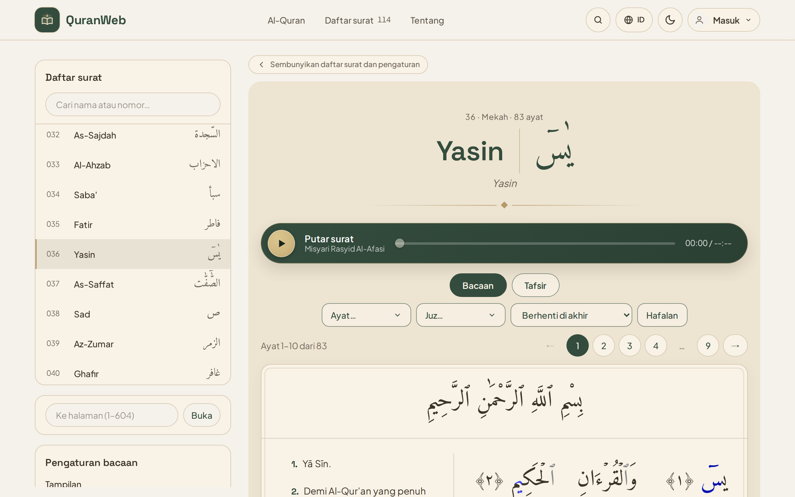
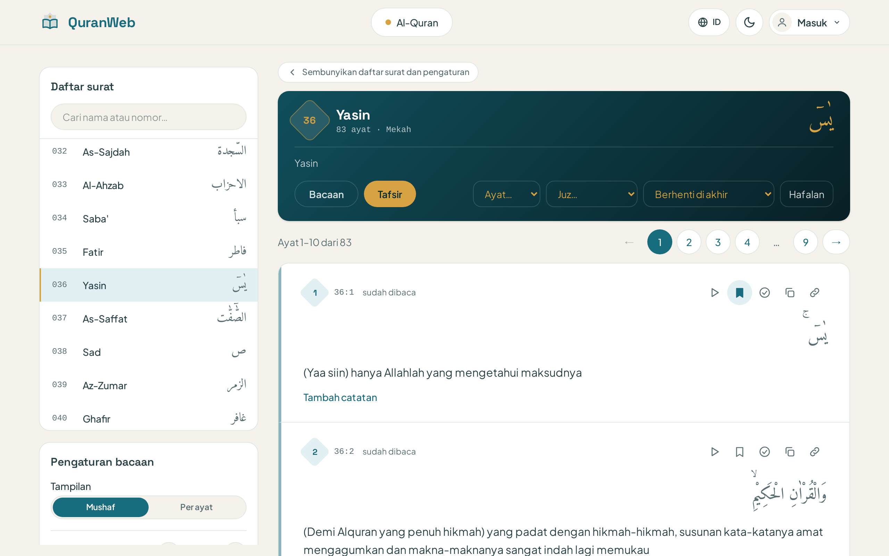
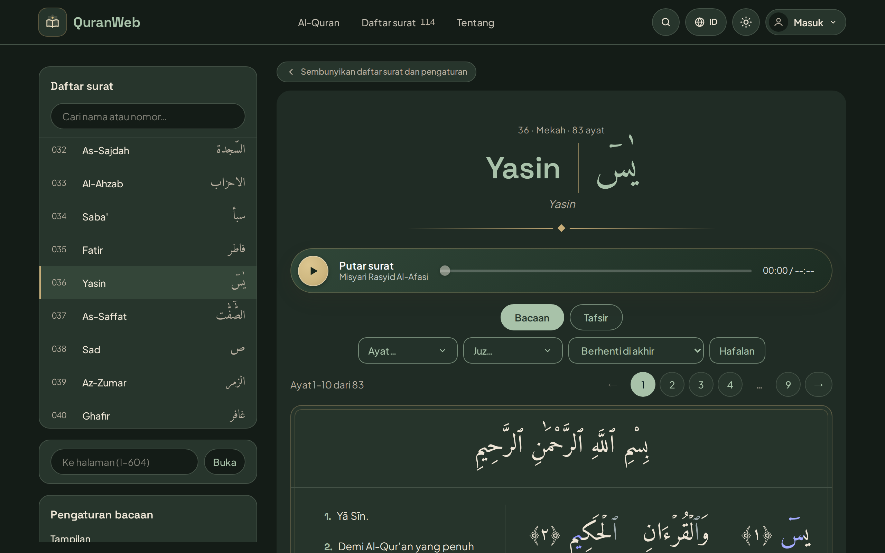
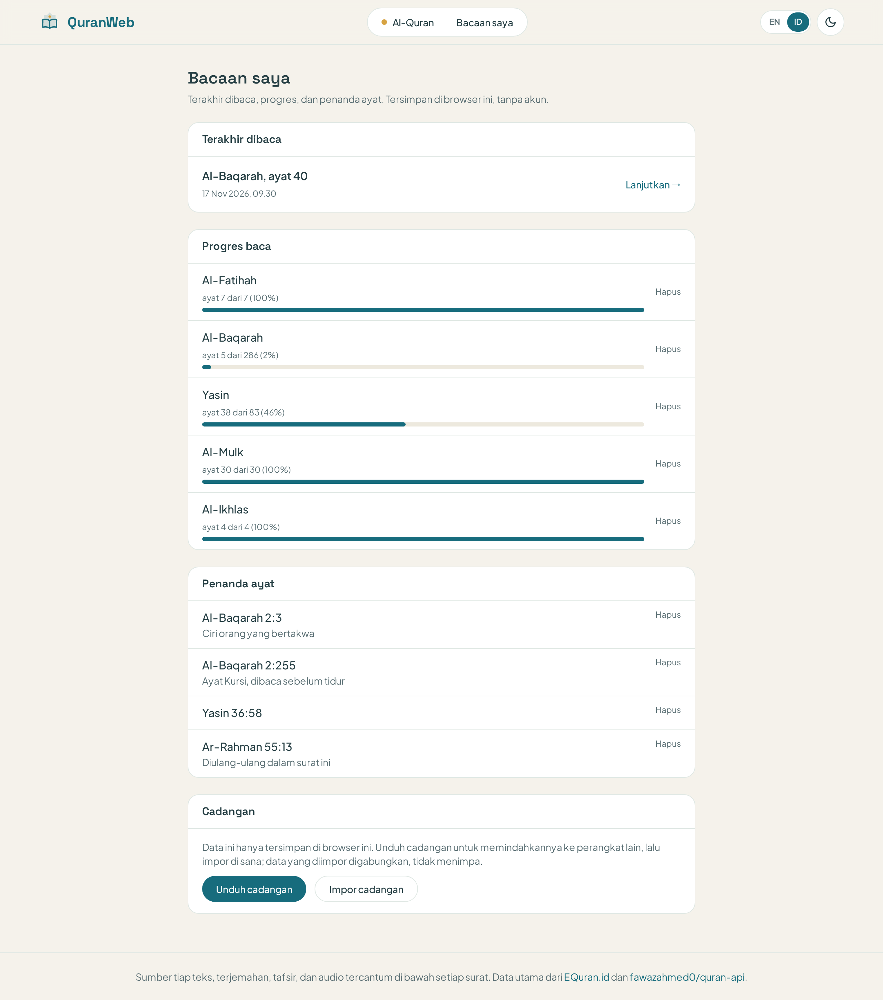

# QuranWeb

[English](README.md) · **Bahasa Indonesia**

Website bacaan Al-Qur'an: teks Arab, terjemahan Bahasa Indonesia dan Inggris, audio murottal, dan tafsir. Dibangun dengan Next.js, menggantikan versi PHP lama (lihat branch `legacy-php` untuk kode sebelumnya).

Situs: **https://quranweb.udienz.web.id** (produksi) dan https://quranweb-qa.udienz.web.id (QA).



## Fitur

- **Antarmuka bahasa Inggris dan Indonesia**, dipilih dari bahasa browser Anda dan bisa diganti dengan tombol EN/ID. Arti nama surat, terjemahan, dan kredit ikut berganti bahasa.
- **Membaca** 114 surat: teks Arab (Uthmani Hafs atau teks EQuran.id), transliterasi Latin, dan satu atau beberapa terjemahan berdampingan (Kemenag Indonesia, Yusuf Ali, Pickthall, ...).
- **Tampilan mushaf** (bawaan): teks Arab satu halaman menyatu dalam satu blok dengan penanda di akhir tiap ayat, seperti mushaf cetak, dan terjemahan ada di sampingnya (di bawahnya di ponsel). Pilih sebuah ayat untuk memutar, memberi penanda, atau menandai sudah dibaca. Tampilan kartu per ayat bisa dipilih di pengaturan.
- **Bacaan berhalaman**: surat yang panjang dibagi menjadi halaman berisi 10 ayat (`?page=3`), sehingga satu halaman tetap pendek dan cepat dimuat (Al-Baqarah turun dari sekitar 2 MB menjadi sekitar 230 KB). Tautan ke ayat, menu lompat, "lanjutkan membaca", dan audio yang lanjut otomatis semuanya bekerja lintas halaman.
- Tab **Tafsir** dengan tafsir pilihan Anda (Kemenag, Quraish Shihab, Jalalayn).
- **Audio** per ayat dari enam qari, otomatis lanjut ke ayat berikutnya.
- **Bacaan Anda, tanpa akun**: mengingat posisi terakhir ("lanjutkan membaca"), menandai ayat sudah dibaca sampai titik tertentu, memberi penanda ayat dengan catatan dan mengelompokkannya ke dalam koleksi, memasang target harian (ayat per hari, dengan runtutan dan progres menuju khatam), dan mencadangkan semuanya sebagai berkas JSON. Tersimpan di browser Anda. Di situs yang mengaktifkan fitur masuk, Anda bisa masuk (opsional) agar bacaan tersimpan di semua perangkat, serta mengunduh atau menghapusnya kapan saja (lihat `/privacy`).
- **Pilihan** teks Arab, terjemahan, tafsir, qari, dan tampilan, tersimpan di browser dan, bila Anda masuk, ikut akun Anda. "Bacaan saya" dan tombol masuk ada di menu akun di kanan atas.
- Tema terang dan gelap, nyaman di ponsel, salin ayat atau tautannya.
- Halaman **Tentang** mencantumkan sumber, kredit, dan lisensi setiap teks, terjemahan, tafsir, dan murotal; setiap surat dan footer menautkannya.

### Tangkapan layar

Gambar menampilkan antarmuka bahasa Indonesia; README bahasa Inggris menampilkan yang berbahasa Inggris.

| | |
|---|---|
|  |  |
| Tab Tafsir, di sini dengan Tafsir Jalalayn | Tema gelap |
|  |  |
| Beranda dengan "lanjutkan membaca" | "Bacaan saya": terakhir dibaca, target harian, progres, penanda |

Di ponsel, pengaturan ada di panel lipat di atas surat:

<p>
  
  
</p>

## Lingkungan dan URL

| Lingkungan | URL | Untuk apa | Cara deploy | Sumber data |
|---|---|---|---|---|
| **Produksi** | https://quranweb.udienz.web.id | situs publik | otomatis saat tag rilis `v*` di-push (`deploy-prod.yml`), hanya untuk commit yang sudah ada di `master` | mirror sendiri di `/api/v2` dan `/quran-api` pada domain yang sama |
| **QA** | https://quranweb-qa.udienz.web.id | uji sebelum rilis | otomatis di setiap push ke `master` (`deploy-qa.yml`) | mirror sendiri di domainnya |
| Lokal | http://localhost:3000 | pengembangan | `npm run dev` | EQuran.id dan fawazahmed0 langsung (bawaan) |

Keduanya berjalan di satu VM yang sama: container Docker (`quranweb-prod` dan `quranweb-qa`) di belakang nginx dengan sertifikat Let's Encrypt (certbot), dan DNS lewat Cloudflare. Deploy memakai SSH dan `scripts/deploy.sh`, yang membangun image di server dan kembali ke image sebelumnya kalau aplikasi baru tidak merespons. Rilis pertama: `v2.0.0` (2026-11-17).

## Menjalankan secara lokal

Butuh Node.js 24 atau lebih baru (image Docker dan CI memakai Node 26, LTS terbaru).

```bash
npm install
npm run dev
```

Buka [http://localhost:3000](http://localhost:3000). Jalankan tes (tanpa jaringan) dengan `npm test`; `npm run test:live` memeriksa sumber nyata (sekitar 8 menit).

## Sumber data

Aplikasi tidak bergantung pada format satu API saja. Semuanya dipetakan ke **skema berbasis edisi** (satu edisi = satu teks Arab, transliterasi, terjemahan, atau tafsir) lewat **provider** di `src/lib/quran/`. Provider, edisi bawaan, dan qari bawaan dikonfigurasi di satu tempat (`defaultConfig` di `src/lib/quran/index.ts`), provider dicoba menurut urutan prioritas dengan fallback, dan audio punya provider sendiri. Menambah sumber berarti menulis provider lalu mendaftarkannya; UI tidak berubah.

| Sumber | Menyediakan | Variabel (opsional) |
|---|---|---|
| [EQuran.id API v2](https://equran.id/apidev/v2) | teks Arab, transliterasi Latin, terjemahan dan tafsir Indonesia (Kemenag), audio enam qari | `QURAN_API_URL` (bawaan `https://equran.id/api/v2`), `QURAN_AUDIO_URL` (bawaan `https://cdn.equran.id`) |
| [fawazahmed0/quran-api](https://github.com/fawazahmed0/quran-api) | edisi tambahan, hanya teks: Arab Uthmani Hafs, Indonesia (Kemenag, Quraish Shihab, Jalalayn), Inggris (Yusuf Ali, Pickthall) | `QURAN_FAWAZ_URL` (bawaan jsDelivr dengan cadangan raw GitHub) |

Variabel sengaja tanpa prefix `NEXT_PUBLIC_`: dibaca di server saat request (halaman tidak di-prerender saat build), jadi bisa diganti lewat environment variable platform atau `docker run -e` tanpa rebuild. Lihat `.env.example`.

Di produksi kedua sumber teks disajikan dari mirror statis milik sendiri, jadi situs tidak memanggil pihak ketiga untuk teks:

- `/api/v2/...` berformat EQuran.id.
- `/quran-api/...` berformat fawazahmed0 (`editions.json`, `info.json`, `editions/{edisi}/{surat}.json`).

Keduanya berkas JSON biasa yang disimpan di repo data terpisah. Audio murottal masih dari `cdn.equran.id`. Sumber tiap edisi dicantumkan di UI dan di entrinya pada `editions.json`.

Basis URL juga bisa berupa **direktori berisi salinan lokal data itu** (misalnya `/data/api/v2`), dan aplikasi lalu tidak membuat permintaan HTTP sama sekali untuk teks: QA dan produksi berjalan seperti ini, dengan direktori mirror dipasang read-only ke container. Untuk mengubah provider yang aktif, urutannya, edisi yang diaktifkan, dan nilai bawaan tanpa menyentuh kode, arahkan `QURAN_CONFIG` ke berkas JSON (lihat `config/sources.example.json`, yang membaca salinan lokal lebih dulu lalu beralih ke EQuran.id). Ketiga variabel di atas hanya mengisi `baseUrl` yang tidak ditulis di berkas itu.

## Docker

Ada `Dockerfile` (multi-stage, pakai [output `standalone`](https://nextjs.org/docs/app/api-reference/config/next-config-js/output) Next.js, image akhir berbasis `node:26-alpine`) yang juga dipakai untuk deploy ke server.

```bash
# build image
docker build -t quranweb .

# jalankan (variabel QURAN_* opsional)
docker run -p 3000:3000 quranweb
```

Atau pakai `docker-compose.yml` (edit variabelnya di file itu dulu):

```bash
docker compose up --build
```

Build image tidak butuh akses jaringan ke sumber data sama sekali: halaman di-render per request (`export const instant = false`), bukan di-generate statis saat `next build` atau `docker build`.

## CI (GitHub Actions)

Workflow di `.github/workflows/`:

- **`ci.yml`**: jalan di tiap push ke `master` dan tiap PR: `npm run lint`, `npm test`, dan `npm run build` (sudah termasuk type-check).
- **`deploy-qa.yml`** dan **`deploy-prod.yml`**: deploy ke server lewat SSH (lihat `CLAUDE.md`). `Dockerfile` divalidasi saat deploy: image dibangun di server dan dikembalikan ke versi sebelumnya kalau app baru tidak merespons, jadi tidak ada build Docker terpisah di CI.

## Bahasa dokumentasi

[README.md](README.md) berbahasa Inggris dan README ini versi Bahasa Indonesia-nya. Jaga keduanya tetap sama: setiap perubahan di salah satunya harus dilakukan juga di yang lain dalam commit yang sama.
