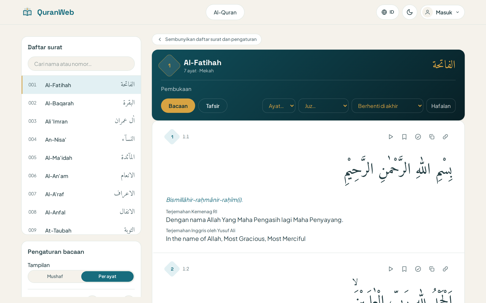
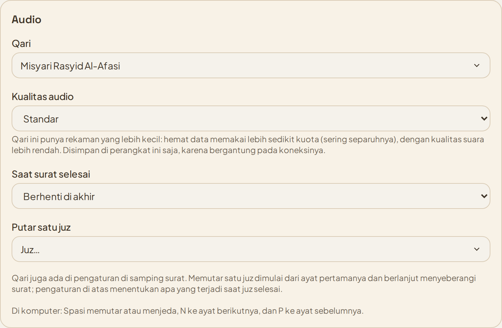
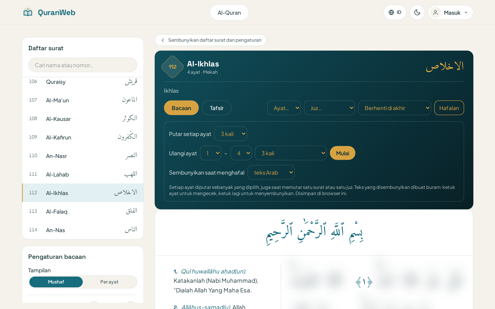
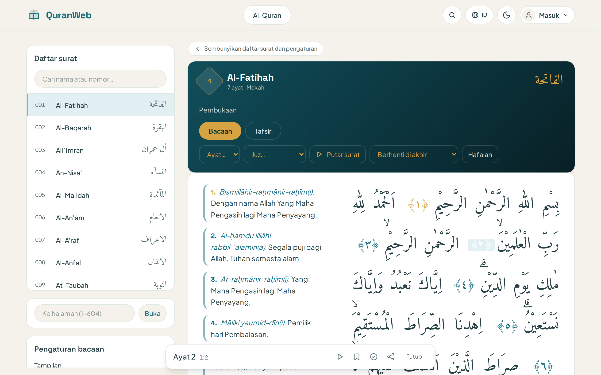
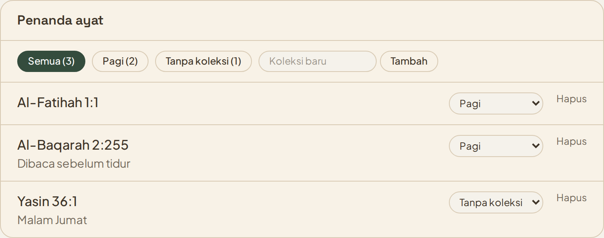
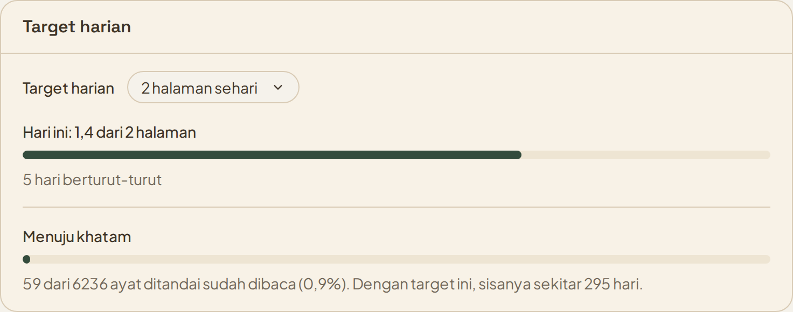
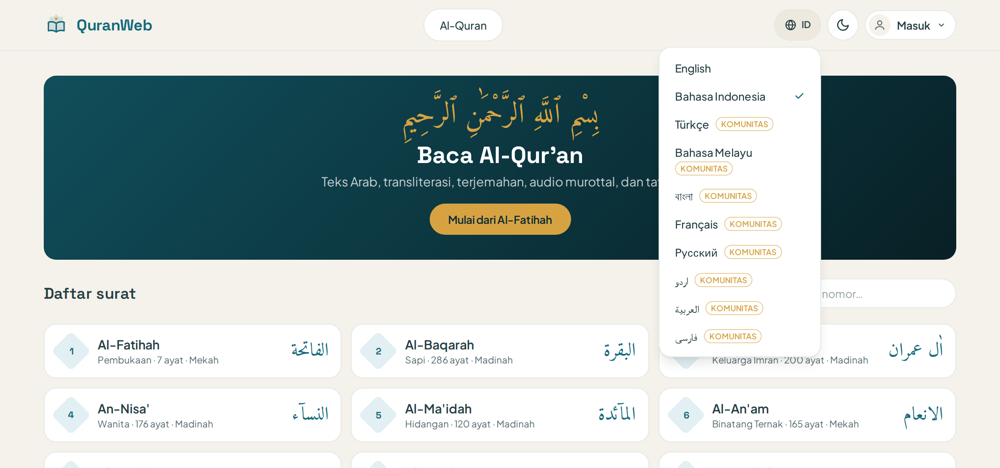
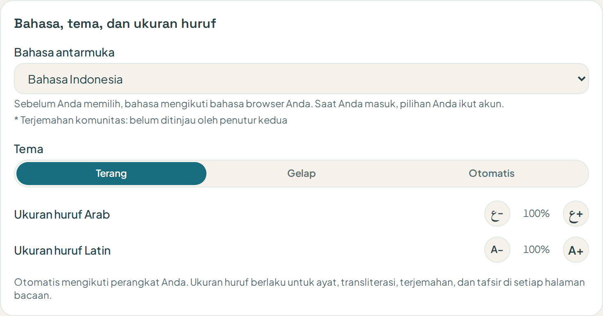
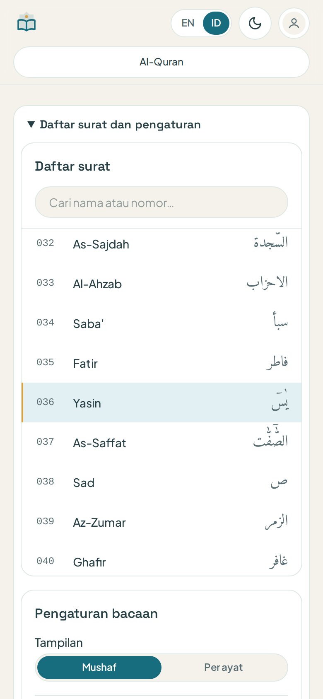

# QuranWeb

[English](README.md) · **Bahasa Indonesia**

Website gratis untuk membaca Al-Qur'an: teks Arab, terjemahan (bahasa Indonesia, Inggris, Turki, Melayu, Bengali, Prancis, Rusia, Urdu, Persia, Spanyol, Bosnia, Tionghoa, Thai, Uzbek, Tamil, Malayalam, Jerman, Portugis, Hindi, Swahili, Hausa, Jepang, Vietnam, dan lainnya), audio
murottal, dan tafsir. Anda tidak perlu akun, dan tidak ada iklan. Kunjungan dihitung dengan Cloudflare Web Analytics, yang
menurut Cloudflare tidak memasang kuki dan tidak mengenali Anda (lihat kebijakan privasi).

**Buka di https://quranweb.udienz.web.id**

## Yang bisa Anda lakukan

- **Membaca 114 surat** dalam teks Arab (Uthmani Hafs atau teks EQuran.id), dengan transliterasi Latin dan satu atau
  beberapa terjemahan berdampingan (Kemenag Indonesia, Yusuf Ali, Pickthall, dan lainnya). ([caranya](#memilih-teks-dan-terjemahan))
- **Membaca seperti mushaf cetak**: teks Arab satu halaman menyatu dalam satu blok, dengan terjemahan di sampingnya (di
  bawahnya di ponsel). Lebih suka satu kartu per ayat? Ganti di pengaturan. ([caranya](#mengganti-tampilan-mushaf-atau-per-ayat))
- **Mendengarkan** murottal per ayat dari 23 qari. Yang paling dikenal ada di atas daftar, dan Anda bisa mencari namanya.
  Audio lanjut sendiri ke ayat berikutnya; di akhir surat audio berhenti, mengulang surat, atau lanjut ke surat berikutnya,
  sesuai pilihan Anda. Anda juga bisa **memutar satu juz penuh**, menyeberangi surat. ([caranya](#mendengarkan-murottal))
- **Mengendalikan audio** dari layar kunci ponsel (jeda, ayat berikutnya), atau di komputer dengan Spasi (putar atau jeda)
  serta N dan P (ayat berikutnya dan sebelumnya). Mode hemat data memutar berkas yang lebih kecil untuk kuota seluler. ([caranya](#mengendalikan-audio))
- **Menghafal**: dengarkan setiap ayat dua, tiga kali, atau lebih, ulangi rentang ayat (misalnya 2:1–5) sebanyak
  yang Anda mau, dan buramkan teks Arab atau terjemahan untuk menguji diri, lalu ketuk ayat untuk mengecek. ([caranya](#menghafal-ayat))
- **Membaca tafsir** sebuah ayat di tab Tafsir (Kemenag, Quraish Shihab, Jalalayn, atau Al-Mukhtasar;
  Al-Mukhtasar juga dalam bahasa Arab, Inggris, Turki, Bengali, Prancis, Rusia, Persia, Bosnia, Tionghoa, Thai, Uzbek, Tamil,
  Malayalam, Italia, Hindi, Jepang, dan Vietnam). ([caranya](#membaca-tafsir))
- **Melanjutkan dari posisi terakhir** dengan "lanjutkan membaca", dan menandai sampai mana Anda sudah membaca. ([caranya](#melanjutkan-bacaan-dan-menandai-progres))
- **Memberi penanda ayat**, menambahkan catatan sendiri, dan mengelompokkannya ke dalam koleksi. ([caranya](#penanda-ayat-catatan-dan-koleksi))
- **Memasang target harian** (ayat per hari), menjaga runtutan, dan melihat progres menuju khatam. ([caranya](#memasang-target-harian))
- **Memakai bahasa Anda**: antarmuka tersedia dalam 25 bahasa (daftarnya di bagian [Bahasa](#bahasa)); Urdu, Arab, dan
  Persia dibaca dari kanan ke kiri. Selain bahasa Indonesia dan Inggris, semuanya terjemahan komunitas yang belum diperiksa
  penutur kedua (bahasa Turki diterjemahkan seorang pembaca, dua puluh dua lainnya draf awal oleh Claude, sebuah AI). Menu
  menandainya dengan tanda bintang (*) dan sebuah catatan, dan masing-masing punya tautan untuk melaporkan kesalahan. Setiap bahasa menampilkan terjemahan dan tafsir dalam bahasa itu
  sebagai bawaan, atau dalam bahasa Inggris bila sumber kami tidak punya. Bahasanya mengikuti browser Anda sampai Anda
  memilih sendiri di header atau halaman Pengaturan. Saat Anda masuk, pilihan Anda ikut akun. ([caranya](#mengganti-bahasa))
- **Membuatnya nyaman dibaca**: tema terang, gelap, atau otomatis, serta huruf Arab dan Latin yang bisa diperbesar atau
  diperkecil masing-masing, di halaman Pengaturan. Saat Anda masuk, pengaturan ikut ke perangkat Anda yang lain. ([caranya](#tema-dan-ukuran-huruf))
- **Menyalin ayat**, atau tautannya. ([caranya](#menyalin-ayat-atau-tautannya)) Tautan ke sebuah surat menampilkan pratinjau berisi namanya,
  artinya, dan jumlah ayatnya saat ditempel di WhatsApp, Telegram, atau X.
- **Memasangnya sebagai aplikasi** di ponsel atau komputer, dengan ikon dan jendela sendiri: "Instal aplikasi" di
  Chrome atau Edge, "Tambahkan ke Layar Utama" di Safari pada iPhone. Tetap butuh koneksi internet. ([caranya](#memasang-sebagai-aplikasi))

Surat yang panjang dibagi menjadi halaman berisi 10 ayat: satu halaman Al-Baqarah sekitar 230 KB, dibanding sekitar 2 MB
untuk seluruh surat.

## Bahasa

Antarmuka tersedia dalam 25 bahasa di bawah ini, diurutkan seperti di menu bahasa: menurut abjad nama bahasa itu sendiri,
huruf Latin lebih dulu, masing-masing dengan benderanya. Memilih salah satunya juga menentukan terjemahan dan tafsir yang
pertama kali dilihat pembaca baru; keduanya bisa diganti di Pengaturan bacaan, dan semua terjemahan dan tafsir bisa dipilih
apa pun bahasa antarmukanya. Bila sumber kami tidak punya terjemahan atau tafsir dalam suatu bahasa, situs menampilkan yang
berbahasa Inggris: sel itu bertuliskan "Inggris".

| Antarmuka | Terjemahan bawaan | Tafsir bawaan |
|---|---|---|
| Bahasa Indonesia | Kemenag | Kemenag |
| Bahasa Melayu | Abdullah Basmeih | Kemenag (bahasa Indonesia, yang mudah diikuti pembaca Melayu) |
| Bosanski (Bosnia) | Rowwad Translation Center | Al-Mukhtasar |
| Deutsch (Jerman) | Frank Bubenheim dan Nadeem Elyas | Inggris: Al-Mukhtasar |
| English (Inggris) | Yusuf Ali | Al-Mukhtasar |
| Español (Spanyol) | Isa Garcia | Inggris: Al-Mukhtasar |
| Français (Prancis) | Rachid Maach | Al-Mukhtasar |
| Hausa | Abubakar Mahmoud Gumi | Inggris: Al-Mukhtasar |
| Italiano (Italia) | Inggris: Yusuf Ali | Al-Mukhtasar |
| Kiswahili (Swahili) | Ali Muhsin Al-Barwani | Inggris: Al-Mukhtasar |
| Português (Portugis) | Helmi Nasr | Inggris: Al-Mukhtasar |
| Tiếng Việt (Vietnam) | Rowwad Translation Center | Al-Mukhtasar |
| Türkçe (Turki) | Diyanet İşleri | Al-Mukhtasar |
| Русский (Rusia) | Elmir Kuliev | Al-Mukhtasar |
| Ўзбекча (Uzbek) | Rowwad Translation Center | Al-Mukhtasar |
| اردو (Urdu) | Muhammad Junagarhi | Inggris: Al-Mukhtasar |
| العربية (Arab) | tidak ada (hanya teks Arab) | Al-Mukhtasar berbahasa Arab |
| فارسی (Persia) | Rowwad Translation Center | Al-Mukhtasar |
| हिन्दी (Hindi) | Azizul Haq Al-Omari | Al-Mukhtasar |
| বাংলা (Bengali) | Muhiuddin Khan | Al-Mukhtasar |
| தமிழ் (Tamil) | Omar Sharif | Al-Mukhtasar |
| മലയാളം (Malayalam) | Abdul Hamid Haidar dan Kunhi Muhammad | Al-Mukhtasar |
| ไทย (Thai) | Rowwad Translation Center | Al-Mukhtasar |
| 中文 (Tionghoa) | Ma Jian | Al-Mukhtasar |
| 日本語 (Jepang) | Saeed Sato | Al-Mukhtasar |

Kecuali tabel menyebut lain, terjemahan atau tafsir itu berbahasa sesuai barisnya.

Semua bahasa selain Bahasa Indonesia dan English adalah terjemahan komunitas, ditandai tanda bintang (*) di menu: belum
ada penutur kedua yang meninjaunya. Kalau Anda menguasai salah satunya, tinjauan Anda adalah bantuan yang paling berguna,
karena tinjauan itulah yang menjadikan bahasa tersebut resmi. Caranya ada di [CONTRIBUTING.md](CONTRIBUTING.md) (dalam
bahasa Inggris), bagian "From community to official".

## Cara memakai

Gambar menampilkan antarmuka bahasa Indonesia; README bahasa Inggris menampilkan yang berbahasa Inggris. Penanda, target,
dan progres di gambar adalah data contoh.

Sebagian besar pilihan ada di **Pengaturan bacaan**, di bawah daftar surat di kiri halaman surat. Di ponsel, buka panel
lipat "Daftar surat dan pengaturan" di atas surat. Semua pengaturan juga ada di halaman **Pengaturan**: buka tombol orang
di kanan atas (bertuliskan "Masuk" selama Anda belum masuk), lalu pilih Pengaturan.

### Memilih teks dan terjemahan

1. Buka surat dari beranda, atau ketik nama atau nomornya di kotak pencarian di atas daftar surat.
2. Di Pengaturan bacaan, pilih teks Arab, lalu bahasa di bagian Terjemahan dan satu atau beberapa terjemahan dalam bahasa
   itu. Setiap terjemahan yang ditambahkan muncul di bawah ayat; hapus dengan tanda silang di labelnya.
3. Nyalakan atau matikan teks Arab, transliterasi, atau terjemahan di panel yang sama.

### Mengganti tampilan mushaf atau per ayat

Gambar di bagian atas halaman ini adalah tampilan mushaf.

1. Di Pengaturan bacaan, pada Tampilan, pilih **Mushaf** atau **Per ayat**.
2. Di layar lebar, "Sembunyikan daftar surat dan pengaturan" di atas surat membuat teks memakai seluruh lebar.

### Mendengarkan murottal

1. Pilih qari di Pengaturan bacaan atau di bagian Audio halaman Pengaturan. Ketik sebagian nama di kotak pencarian di
   atas daftar untuk mencarinya.
2. Tekan putar di sebuah ayat. Di tampilan mushaf, ketuk nomor ayat dulu: bilah berisi tombol putar muncul di bawah.
3. Untuk memilih apa yang terjadi di akhir surat, pakai daftar di kepala surat (Berhenti di akhir, Ulangi surat, Putar
   surat berikutnya).
4. Untuk memutar satu juz penuh, pilih di daftar "Juz…" di kepala surat atau di "Putar satu juz" pada halaman Pengaturan.

### Mengendalikan audio

- Di ponsel, layar kunci menampilkan ayat dan qari, dengan jeda serta ayat berikutnya dan sebelumnya. Tidak perlu diatur.
- Di komputer, di halaman surat: Spasi memutar atau menjeda, N pindah ke ayat berikutnya, P ke ayat sebelumnya.
- Kalau memakai kuota seluler, setel Kualitas audio ke "Hemat data" di bagian Audio halaman Pengaturan (gambar di atas).
  Pilihan ini hanya berlaku di perangkat itu. Untuk sebagian qari pilihan ini tidak mengubah apa pun, dan teks di bawah
  daftar memberi tahu.

### Menghafal ayat

1. Buka suratnya dan tekan **Hafalan** di kepala surat.
2. "Putar setiap ayat" mengatur berapa kali setiap ayat diputar sebelum lanjut.
3. "Ulangi ayat": pilih ayat pertama dan terakhir serta berapa kali, lalu tekan **Mulai**. Tekan Berhenti untuk
   menghentikannya lebih awal.
4. "Sembunyikan saat menghafal" memburamkan teks Arab atau terjemahan. Ketuk ayat yang buram untuk mengecek, dan ketuk
   lagi untuk menyembunyikannya.

### Membaca tafsir

1. Buka tab **Tafsir** di kepala surat.
2. Pilih tafsirnya di Pengaturan bacaan, bagian Tafsir.

### Melanjutkan bacaan dan menandai progres

1. Cukup membaca: situs mencatat ayat yang Anda capai. "Lanjutkan membaca" di beranda membawa Anda kembali ke sana.
2. Untuk menandai sampai mana Anda sudah membaca, tekan tombol centang di sebuah ayat ("Tandai sudah dibaca sampai ayat
   ini"). Di tampilan mushaf, tombol ini ada di bilah yang muncul saat Anda mengetuk nomor ayat. Ayat yang sudah ditandai
   mendapat garis di sampingnya.
3. Progres per surat ada di halaman **Bacaan saya** (tombol orang di kanan atas, lalu Bacaan saya).

### Penanda ayat, catatan, dan koleksi

1. Tekan tombol penanda di sebuah ayat.
2. Ayat yang diberi penanda menampilkan "Tambah catatan" di bawahnya: tulis catatan Anda di sana.
3. Di Bacaan saya, bagian Penanda ayat, ketik nama di "Koleksi baru" lalu tekan **Tambah**. Setelah itu masukkan penanda
   ke koleksi lewat daftar di samping penanda itu. Tombol di bagian atas menampilkan satu koleksi saja.

### Memasang target harian

1. Di Bacaan saya, bagian Target harian, pilih berapa ayat per hari.
2. Yang terhitung hanya ayat yang Anda tandai sudah dibaca (lihat di atas); membaca tanpa menandai tidak dihitung.
3. Halaman itu menampilkan jumlah hari ini, berapa hari berturut-turut target tercapai, dan seberapa jauh menuju khatam.

### Mengganti bahasa

Tekan tombol bola dunia di atas (bertuliskan kode bahasa yang sedang dipakai, misalnya ID atau EN) dan pilih bahasa, atau pakai "Bahasa antarmuka" di halaman
Pengaturan. Bahasa diurutkan menurut abjad nama bahasa itu sendiri, masing-masing dengan benderanya; menunya bisa digulir
bila lebih tinggi dari layar. Ini hanya mengganti menu dan tombol. Terjemahan Al-Qur'an dipilih di Pengaturan bacaan.

### Tema dan ukuran huruf

1. Tombol bulan atau matahari di atas berganti antara terang dan gelap.
2. Untuk tema otomatis, yang mengikuti perangkat Anda, dan untuk ukuran huruf, buka halaman Pengaturan, bagian "Bahasa,
   tema, dan ukuran huruf". Huruf Arab dan huruf Latin punya tombol ukuran masing-masing.

### Menyalin ayat atau tautannya

Tekan tombol salin di sebuah ayat untuk menyalin teksnya, atau tombol tautan untuk menyalin tautan langsung ke ayat itu.
Di tampilan mushaf, ketuk nomor ayat dulu (gambar di bagian "Melanjutkan bacaan dan menandai progres").

### Memasang sebagai aplikasi

- Chrome atau Edge di komputer atau ponsel Android: pilih "Instal aplikasi" (di bilah alamat atau menu browser).
- Safari di iPhone: tombol Bagikan, lalu "Tambahkan ke Layar Utama".

Aplikasinya tetap butuh koneksi internet.

## Bacaan dan privasi Anda

Tanpa akun, semua yang Anda lakukan (posisi terakhir, penanda, catatan, target) tersimpan di browser Anda di perangkat
itu. Dari "Bacaan saya" Anda bisa menyimpannya ke berkas dan mengimpornya lagi, di perangkat yang sama atau yang lain.

Kalau ingin bacaan yang sama di ponsel dan komputer, Anda bisa masuk dengan akun Google. Ini opsional. Anda bisa
mengunduh semua yang tersimpan di akun, atau menghapus akun, kapan saja. Apa yang disimpan dan alasannya ada di kebijakan
privasi: https://quranweb.udienz.web.id/privacy.

## Sumber dan kredit

Teks Arab, terjemahan, dan tafsir berasal dari sumber yang sudah diterbitkan: [EQuran.id](https://equran.id) (teks Arab,
terjemahan, dan tafsir Kementerian Agama RI, serta murottal), [fawazahmed0/quran-api](https://github.com/fawazahmed0/quran-api), dan
[QuranEnc.com](https://quranenc.com); murottal lainnya dari CDN audio [AlQuran.cloud](https://alquran.cloud/cdn). Halaman
**Tentang**, yang ditautkan di bagian bawah setiap halaman, mencantumkan sumber, kredit, dan lisensi setiap teks,
terjemahan, tafsir, dan murottal.

## Di ponsel

Di layar lebar daftar surat dan pengaturan ada di samping surat; di ponsel keduanya ada di panel lipat di atasnya:

  
  

## Masukan dan bantuan

Menemukan kesalahan, atau punya ide? [Buka issue](https://github.com/udienz/quranweb/issues). Terima kasih kepada semua
yang telah membantu: lihat [CONTRIBUTORS.md](CONTRIBUTORS.md).

Anda juga bisa membantu dengan menerjemahkan antarmuka (menu, tombol, halaman) ke bahasa Anda. Al-Qur'an sendiri tidak
pernah diterjemahkan dengan cara ini. Caranya: [CONTRIBUTING.md](CONTRIBUTING.md) (dalam bahasa Inggris), bagian
"Translating the interface".

## Lisensi

**Kode** QuranWeb bebas dipakai, diubah, dan dibagikan dengan [lisensi MIT](LICENSE), tanpa jaminan apa pun. Teks Al-Qur'an,
terjemahan, tafsir, dan murottal **tidak** tercakup di dalamnya: masing-masing mengikuti ketentuan sumbernya, yang tercantum
di halaman Tentang situs.

## Untuk pengembang

Cara menjalankan secara lokal, Docker, sumber data, lingkungan, dan deploy dijelaskan di
[docs/development.md](docs/development.md) (dalam bahasa Inggris). Konvensi proyek ada di [CLAUDE.md](CLAUDE.md).
