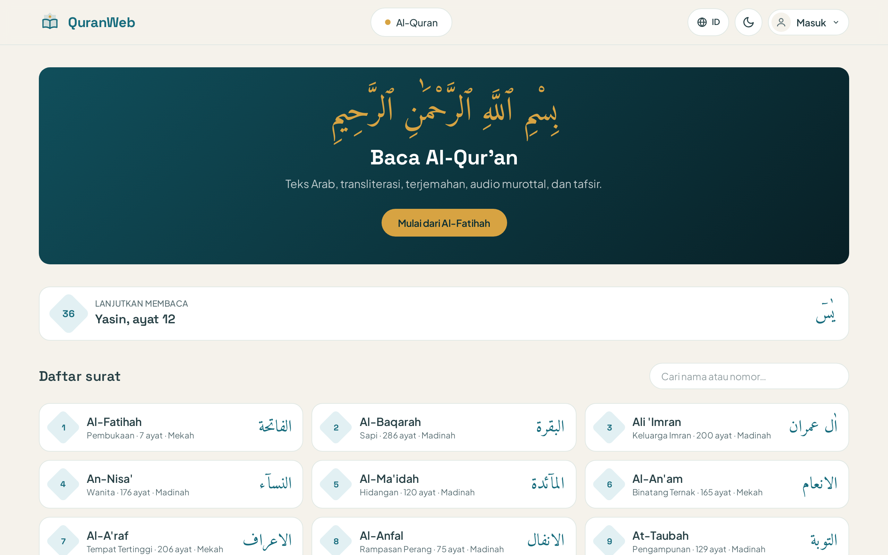
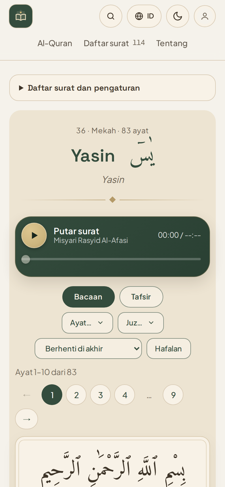

# QuranWeb

[English](README.md) · **Bahasa Indonesia**

Website gratis untuk membaca Al-Qur'an: teks Arab, terjemahan (bahasa Indonesia, Inggris, Turki, dan lainnya), audio
murottal, dan tafsir. Anda tidak perlu akun, dan tidak ada iklan. Kunjungan dihitung dengan Cloudflare Web Analytics, yang
menurut Cloudflare tidak memasang kuki dan tidak mengenali Anda (lihat kebijakan privasi).

**Buka di https://quranweb.udienz.web.id**

## Yang bisa Anda lakukan

- **Membaca 114 surat** dalam teks Arab (Uthmani Hafs atau teks EQuran.id), dengan transliterasi Latin dan satu atau
  beberapa terjemahan berdampingan (Kemenag Indonesia, Yusuf Ali, Pickthall, dan lainnya).
- **Membaca seperti mushaf cetak**: teks Arab satu halaman menyatu dalam satu blok, dengan terjemahan di sampingnya (di
  bawahnya di ponsel). Lebih suka satu kartu per ayat? Ganti di pengaturan.
- **Mendengarkan** murottal per ayat dari 23 qari. Yang paling dikenal ada di atas daftar, dan Anda bisa mencari namanya.
  Audio lanjut sendiri ke ayat berikutnya; di akhir surat audio berhenti, mengulang surat, atau lanjut ke surat berikutnya,
  sesuai pilihan Anda. Anda juga bisa **memutar satu juz penuh**, menyeberangi surat.
- **Mengendalikan audio** dari layar kunci ponsel (jeda, ayat berikutnya), atau di komputer dengan Spasi (putar atau jeda)
  serta N dan P (ayat berikutnya dan sebelumnya). Mode hemat data memutar berkas yang lebih kecil untuk kuota seluler.
- **Menghafal**: dengarkan setiap ayat dua, tiga kali, atau lebih, ulangi rentang ayat (misalnya 2:1–5) sebanyak
  yang Anda mau, dan buramkan teks Arab atau terjemahan untuk menguji diri, lalu ketuk ayat untuk mengecek.
- **Membaca tafsir** sebuah ayat di tab Tafsir (Kemenag, Quraish Shihab, Jalalayn, atau Al-Mukhtasar;
  Al-Mukhtasar juga dalam bahasa Inggris dan Turki).
- **Melanjutkan dari posisi terakhir** dengan "lanjutkan membaca", dan menandai sampai mana Anda sudah membaca.
- **Memberi penanda ayat**, menambahkan catatan sendiri, dan mengelompokkannya ke dalam koleksi.
- **Memasang target harian** (ayat per hari), menjaga runtutan, dan melihat progres menuju khatam.
- **Memakai bahasa Anda**: antarmuka tersedia dalam bahasa Indonesia, Inggris, dan Turki (bahasa Turki adalah terjemahan
  komunitas yang masih menunggu peninjau kedua). Bahasanya mengikuti browser Anda sampai Anda memilih sendiri di header
  atau halaman Pengaturan. Saat Anda masuk, pilihan Anda ikut akun.
- **Membuatnya nyaman dibaca**: tema terang, gelap, atau otomatis, serta huruf Arab dan Latin yang bisa diperbesar atau
  diperkecil masing-masing, di halaman Pengaturan. Saat Anda masuk, pengaturan ikut ke perangkat Anda yang lain.
- **Menyalin ayat**, atau tautannya.
- **Memasangnya sebagai aplikasi** di ponsel atau komputer, dengan ikon dan jendela sendiri: "Instal aplikasi" di
  Chrome atau Edge, "Tambahkan ke Layar Utama" di Safari pada iPhone. Tetap butuh koneksi internet.

Surat yang panjang dibagi menjadi halaman berisi 10 ayat: satu halaman Al-Baqarah sekitar 230 KB, dibanding sekitar 2 MB
untuk seluruh surat.

## Bacaan dan privasi Anda

Tanpa akun, semua yang Anda lakukan (posisi terakhir, penanda, catatan, target) tersimpan di browser Anda di perangkat
itu. Dari "Bacaan saya" Anda bisa menyimpannya ke berkas dan mengimpornya lagi, di perangkat yang sama atau yang lain.

Kalau ingin bacaan yang sama di ponsel dan komputer, Anda bisa masuk dengan akun Google. Ini opsional. Anda bisa
mengunduh semua yang tersimpan di akun, atau menghapus akun, kapan saja. Apa yang disimpan dan alasannya ada di kebijakan
privasi: https://quranweb.udienz.web.id/privacy.

## Sumber dan kredit

Teks Arab, terjemahan, dan tafsir berasal dari sumber yang sudah diterbitkan: [EQuran.id](https://equran.id) (teks Arab,
terjemahan, dan tafsir Kementerian Agama RI, serta murottal), [fawazahmed0/quran-api](https://github.com/fawazahmed0/quran-api), dan
[QuranEnc.com](https://quranenc.com); murottal lainnya dari CDN audio [AlQuran.cloud](https://alquran.cloud/cdn). Halaman
**Tentang**, yang ditautkan di bagian bawah setiap halaman, mencantumkan sumber, kredit, dan lisensi setiap teks,
terjemahan, tafsir, dan murottal.

## Tangkapan layar

Gambar menampilkan antarmuka bahasa Indonesia; README bahasa Inggris menampilkan yang berbahasa Inggris.

| | |
|---|---|
|  |  |
| Tab Tafsir, di sini dengan Tafsir Jalalayn | Tema gelap |
|  |  |
| Beranda dengan "lanjutkan membaca" | "Bacaan saya": terakhir dibaca, target harian, progres, penanda |

Di layar lebar, daftar surat dan pengaturan bisa disembunyikan agar mushaf memakai seluruh lebar; di ponsel keduanya ada di panel lipat di atas surat:

  
  

## Masukan dan bantuan

Menemukan kesalahan, atau punya ide? [Buka issue](https://github.com/udienz/quranweb/issues). Terima kasih kepada semua
yang telah membantu: lihat [CONTRIBUTORS.md](CONTRIBUTORS.md).

Anda juga bisa membantu dengan menerjemahkan antarmuka (menu, tombol, halaman) ke bahasa Anda. Al-Qur'an sendiri tidak
pernah diterjemahkan dengan cara ini. Caranya: [CONTRIBUTING.md](CONTRIBUTING.md) (dalam bahasa Inggris), bagian
"Translating the interface".

## Lisensi

**Kode** QuranWeb bebas dipakai, diubah, dan dibagikan dengan [lisensi MIT](LICENSE), tanpa jaminan apa pun. Teks Al-Qur'an,
terjemahan, tafsir, dan murottal **tidak** tercakup di dalamnya: masing-masing mengikuti ketentuan sumbernya, yang tercantum
di halaman Tentang situs.

## Untuk pengembang

Cara menjalankan secara lokal, Docker, sumber data, lingkungan, dan deploy dijelaskan di
[docs/development.md](docs/development.md) (dalam bahasa Inggris). Konvensi proyek ada di [CLAUDE.md](CLAUDE.md).
