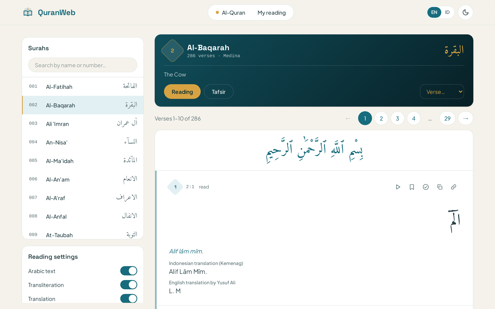

# QuranWeb

**English** · [Bahasa Indonesia](README.id.md)

A website for reading the Qur'an: Arabic text, translations in Indonesian and English, recitation audio, and tafsir. Built with Next.js, replacing the old PHP version (see the `legacy-php` branch for the previous code).

Live: **https://quranweb.udienz.web.id** (production) and https://quranweb-qa.udienz.web.id (QA).



## Features

- **English and Indonesian interface**, chosen from your browser language and switchable with the EN/ID button. Surah names, translations and credits follow the language too.
- **Read** all 114 surahs: Arabic text (Uthmani Hafs or the EQuran.id text), Latin transliteration, and one or more translations side by side (Indonesian Kemenag, Yusuf Ali, Pickthall, ...).
- **Mushaf layout** (the default): the Arabic text of a page runs as one block with a marker after each verse, like a printed mushaf, and the translation sits beside it (below it on phones). Select a verse to play, bookmark or mark it as read. The verse-by-verse cards are one click away in the settings.
- **Paged reading**: a long surah is split into pages of 10 verses (`?page=3`), so a page stays short and fast to load (Al-Baqarah went from about 2 MB to about 230 KB). Links to a verse, the jump menu, "continue reading" and the audio auto-advance all work across pages.
- **Tafsir** tab with a tafsir of your choice (Kemenag, Quraish Shihab, Jalalayn).
- **Audio** per verse from six reciters, with automatic advance to the next verse.
- **Your reading, without an account**: it remembers where you stopped ("continue reading"), lets you mark verses as read up to a point, bookmark verses with notes and group them into collections, set a daily goal (verses a day, with a streak and progress towards a khatam), and back everything up as a JSON file. It is stored in your browser. Where the site has sign-in switched on, you can optionally sign in to keep it on all your devices, and download or delete it at any time (see `/privacy`).
- **Choices** for Arabic text, translations, tafsir, reciter and layout, saved in the browser and, when you sign in, kept with your account. "My reading" and sign-in are in the account menu at the top right.
- Light and dark theme, works on phones, copy a verse or a link to it.
- An **About** page lists the source, credit and licence of every text, translation, tafsir and recitation; the footer of every page links to it.

### Screenshots

The pictures show the English interface; the Indonesian README shows the Indonesian one.

| | |
|---|---|
|  |  |
| Tafsir tab, here with Tafsir Jalalayn | Dark theme |
|  |  |
| Home page with "continue reading" | "My reading": last read, daily goal, progress, bookmarks |

On wide screens the surah list and settings can be hidden so the mushaf uses the whole width; on phones they sit in a collapsible panel above the surah:

<p>
  
  
</p>

## Environments and URLs

| Environment | URL | Purpose | How it is deployed | Data source |
|---|---|---|---|---|
| **Production** | https://quranweb.udienz.web.id | public site | automatically when a `v*` release tag is pushed (`deploy-prod.yml`), only for commits already on `master` | own mirrors at `/api/v2` and `/quran-api` on the same domain |
| **QA** | https://quranweb-qa.udienz.web.id | testing before release | by hand from `master` (`deploy-qa.yml`, Run workflow) | own mirrors on its own domain |
| Local | http://localhost:3000 | development | `npm run dev` | EQuran.id and fawazahmed0 directly (default) |

Both run on the same VM: Docker containers (`quranweb-prod` and `quranweb-qa`) behind nginx with Let's Encrypt certificates (certbot), with DNS through Cloudflare. Deployment uses SSH and `scripts/deploy.sh`, which builds the image on the server and rolls back to the previous image if the new app does not respond. First release: `v2.0.0` (2026-11-17).

## Running locally

Node.js 24 or newer is needed (the Docker image and CI use Node 26, the current LTS).

```bash
npm install
npm run dev
```

Open [http://localhost:3000](http://localhost:3000). Run the tests (no network needed) with `npm test`; `npm run test:live` checks the real sources (about 8 minutes).

## Data sources

The app does not depend on any one API's format. Everything is mapped to an **edition-based schema** (one edition = one Arabic text, transliteration, translation or tafsir) through **providers** in `src/lib/quran/`. The providers, the default editions and the default reciter are configured in one place (`defaultConfig` in `src/lib/quran/index.ts`), providers are tried in priority order with fallback, and audio has its own provider. Adding a source means writing a provider and registering it; the UI does not change.

| Source | Provides | Variable (optional) |
|---|---|---|
| [EQuran.id API v2](https://equran.id/apidev/v2) | Arabic text, Latin transliteration, Indonesian translation and tafsir (Kemenag), audio from six reciters | `QURAN_API_URL` (default `https://equran.id/api/v2`), `QURAN_AUDIO_URL` (default `https://cdn.equran.id`) |
| [fawazahmed0/quran-api](https://github.com/fawazahmed0/quran-api) | more editions, text only: Arabic Uthmani Hafs, Indonesian (Kemenag, Quraish Shihab, Jalalayn), English (Yusuf Ali, Pickthall) | `QURAN_FAWAZ_URL` (default jsDelivr with a raw GitHub fallback) |

The variables intentionally have no `NEXT_PUBLIC_` prefix: they are read on the server at request time (pages are not prerendered at build), so they can be changed through the platform's environment variables or `docker run -e` without a rebuild. See `.env.example`.

In production both text sources are served from our own static mirrors, so the site does not call third parties for text:

- `/api/v2/...` follows the EQuran.id format.
- `/quran-api/...` follows the fawazahmed0 format (`editions.json`, `info.json`, `editions/{edition}/{surah}.json`).

They are plain JSON files kept in a separate data repository. Recitation audio still comes from `cdn.equran.id`. Every edition's source is credited in the UI and in its entry in `editions.json`.

A base URL can also be a **directory with a local copy of that data** (for example `/data/api/v2`), and then the app makes no HTTP request at all for text: QA and production run this way, with the mirror directory mounted read-only into the container. To change which providers are active, their order, which editions are enabled and the defaults without touching code, point `QURAN_CONFIG` to a JSON file (see `config/sources.example.json`, which reads the local copy first and falls back to EQuran.id). The three variables above only fill in a `baseUrl` that the file leaves out.

## Docker

There is a `Dockerfile` (multi-stage, using the Next.js [`standalone` output](https://nextjs.org/docs/app/api-reference/config/next-config-js/output), final image based on `node:26-alpine`), which is also used for server deployment.

```bash
# build the image
docker build -t quranweb .

# run it (the QURAN_* variables are optional)
docker run -p 3000:3000 quranweb
```

Or use `docker-compose.yml` (edit the variables in it first):

```bash
docker compose up --build
```

Building the image needs no network access to the data sources at all: pages are rendered per request (`export const instant = false`) instead of being generated statically during `next build` or `docker build`.

## CI (GitHub Actions)

Workflows in `.github/workflows/`:

- **`ci.yml`**: runs on every push to `master` and every PR: `npm run lint`, `npm test` and `npm run build` (which already includes the type check).
- **`deploy-qa.yml`** and **`deploy-prod.yml`**: deploy to the server over SSH (see `CLAUDE.md`). The `Dockerfile` is validated at deploy time: the image is built on the server and rolled back to the previous version if the new app does not respond, so there is no separate Docker build in CI.

## Contributing

Contributions come as pull requests; see [CONTRIBUTING.md](CONTRIBUTING.md). You can also translate the interface into
your language (the interface only, never the Qur'an itself): the steps and how translations are reviewed are in the
section "Translating the interface".

## Documentation language

This README is in English and [README.id.md](README.id.md) is the Indonesian version. Keep both in sync: any change to one must be made in the other in the same commit.
