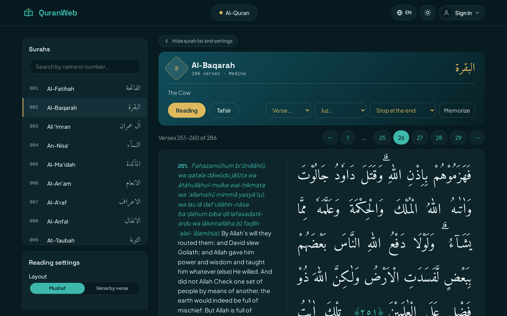
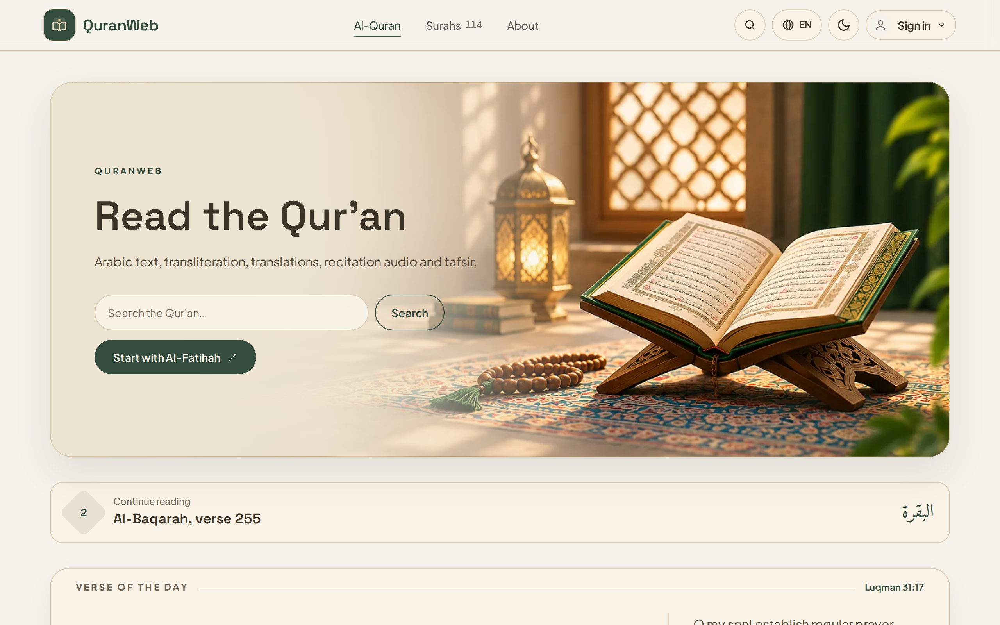
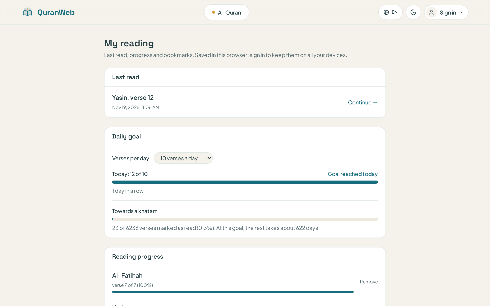
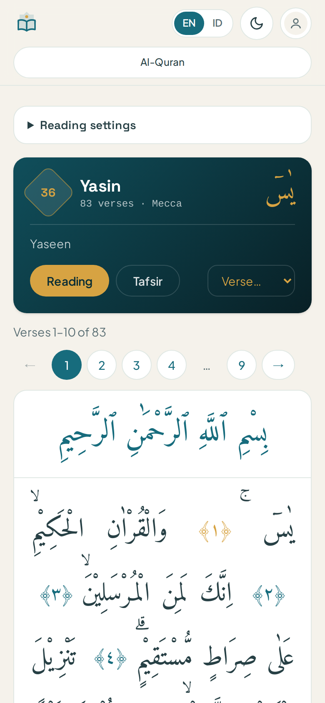
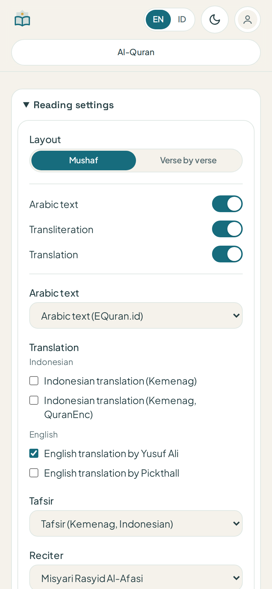

# QuranWeb

**English** · [Bahasa Indonesia](README.id.md)

A free website for reading the Qur'an: the Arabic text, translations in Indonesian and English, recitation audio and
tafsir. You do not need an account, and there are no ads. We only count visits, with Cloudflare Web Analytics: no cookies, and
nothing that identifies you (see the privacy policy).

**Open it at https://quranweb.udienz.web.id**

## What you can do

- **Read all 114 surahs** in the Arabic text (Uthmani Hafs or the EQuran.id text), with a Latin transliteration and one or
  more translations side by side (Indonesian Kemenag, Yusuf Ali, Pickthall and others).
- **Read like a printed mushaf**: the Arabic text of a page runs as one block, with the translation beside it (below it
  on phones). Prefer one card per verse? Switch it in the settings.
- **Listen** to the recitation verse by verse from 23 reciters (the best known at the top of the list, and a search box), with a data-saver
  mode for mobile data; it moves on to the next verse by itself, and your phone's lock screen
  can pause it or skip to the next verse. At the end of a
  surah it can stop, repeat the surah, or carry on with the next one: your choice, kept with your account. You can also
  **play a whole juz**, from its first verse to its last, across surahs.
- **Memorize**: hear each verse two, three or more times, and repeat a range of verses (for example 2:1–5) as many
  times as you like.
- **Read the tafsir** of a verse in the Tafsir tab (Kemenag, Quraish Shihab, Jalalayn or Al-Mukhtasar;
  Al-Mukhtasar also in English and Turkish).
- **Pick up where you stopped** with "continue reading", and mark how far you have read.
- **Bookmark verses**, add your own notes, and group them into collections.
- **Set a daily goal** (verses a day), keep a streak going, and see your progress towards a khatam.
- **Use it in your language**: the interface follows your browser's language (English or Indonesian for now), and the
  language menu in the header, or the Settings page, changes it. When you are signed in, your choice follows you.
- **Make it comfortable**: a light, dark or automatic theme, and larger or smaller Arabic and Latin text, each on its
  own, on the Settings page. When you are signed in, your settings follow you to your other devices.
- Works well on phones, and you can copy a verse or a link to it.
- **Install it as an app** on your phone or computer, with its own icon and window: "Install app" in Chrome or Edge,
  "Add to Home Screen" in Safari on an iPhone. It still needs an internet connection.

Long surahs are split into pages of 10 verses, so every page opens quickly, even on a slow connection.

## Your reading and your privacy

Without an account, everything you do (where you stopped, bookmarks, notes, your goal) stays in your browser on that
device. From "My reading" you can save it to a file and import it again, on the same or another device.

If you want the same reading on your phone and your computer, you can sign in with your Google account. It is optional.
You can download everything kept with your account, or delete the account, at any time. What is kept and why is in the
privacy policy: https://quranweb.udienz.web.id/privacy.

## Sources and credits

The Arabic text, translations and tafsir come from published sources: [EQuran.id](https://equran.id) (the Arabic text,
translation and tafsir of Kementerian Agama RI, and the recitations), [fawazahmed0/quran-api](https://github.com/fawazahmed0/quran-api) and
[QuranEnc.com](https://quranenc.com); more recitations come from the [AlQuran.cloud](https://alquran.cloud/cdn) audio CDN. The **About** page,
linked at the bottom of every page, lists the source, credit and licence of every text, translation, tafsir and
recitation.

## Screenshots

The pictures show the English interface; the Indonesian README shows the Indonesian one.

| | |
|---|---|
|  |  |
| Tafsir tab, here with Tafsir Jalalayn | Dark theme |
|  |  |
| Home page with "continue reading" | "My reading": last read, daily goal, progress, bookmarks |

On wide screens the surah list and settings can be hidden so the mushaf uses the whole width; on phones they sit in a collapsible panel above the surah:

  
  

## Feedback and help

Found a mistake, or have an idea? [Open an issue](https://github.com/udienz/quranweb/issues). Thanks to everyone who has
helped: see [CONTRIBUTORS.md](CONTRIBUTORS.md).

You can also help by translating the interface (menus, buttons, pages) into your language. The Qur'an itself is never
translated this way. How it works: [CONTRIBUTING.md](CONTRIBUTING.md), section "Translating the interface".

## Licence

The **code** of QuranWeb is free to use, change and share under the [MIT licence](LICENSE), without any warranty. The text of
the Qur'an, the translations, the tafsir and the recitations are **not** covered by it: each keeps the terms of its source,
listed on the About page of the site.

## For developers

Running it locally, Docker, the data sources, the environments and deployment are described in
[docs/development.md](docs/development.md). The project's conventions are in [CLAUDE.md](CLAUDE.md).
