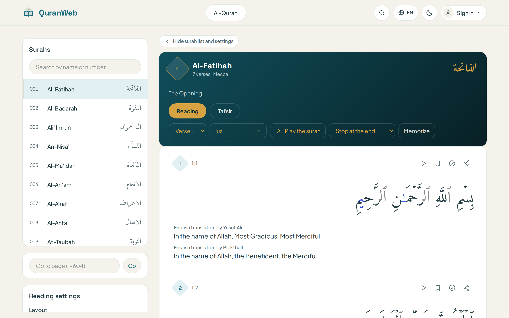
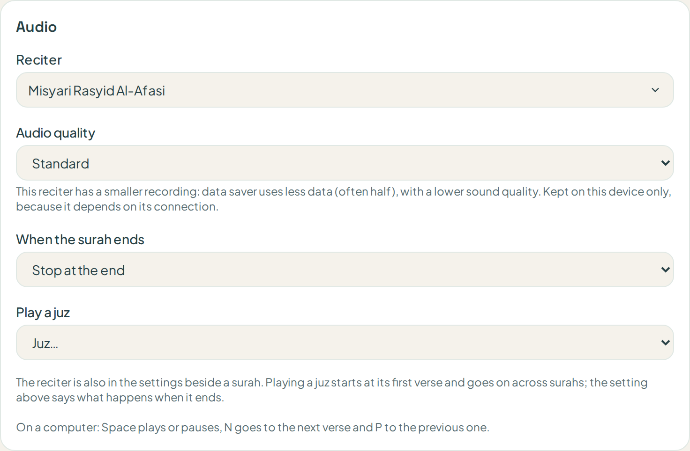
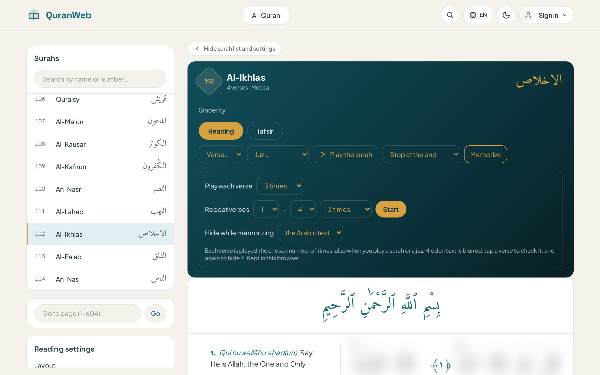
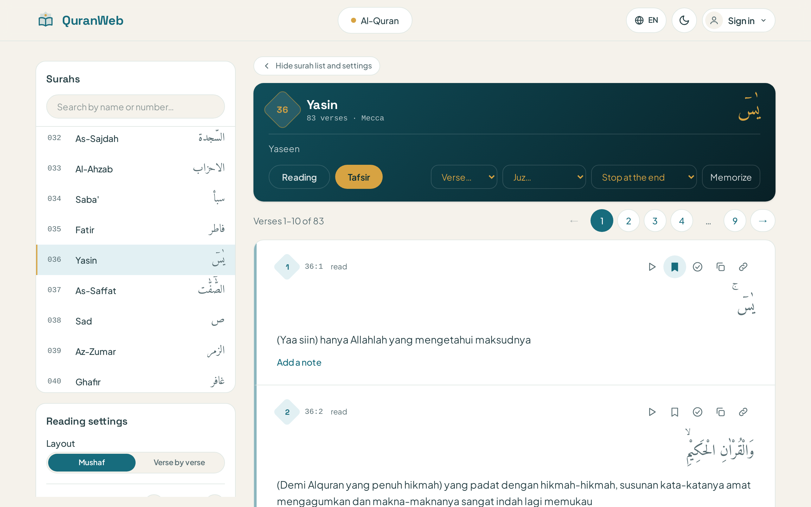
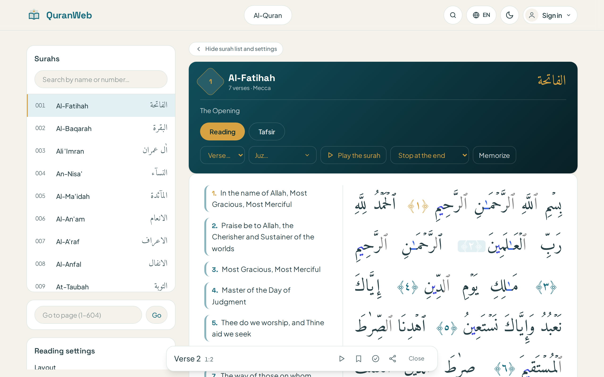
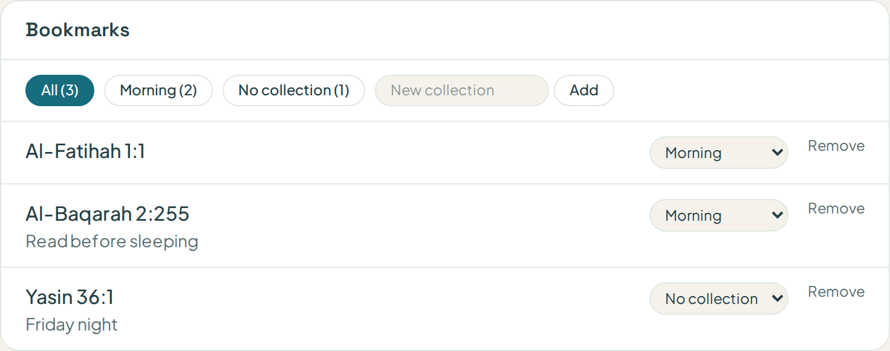
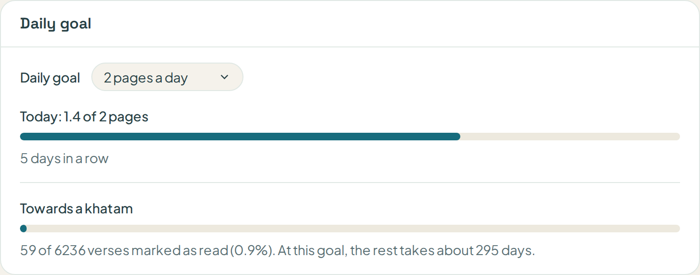
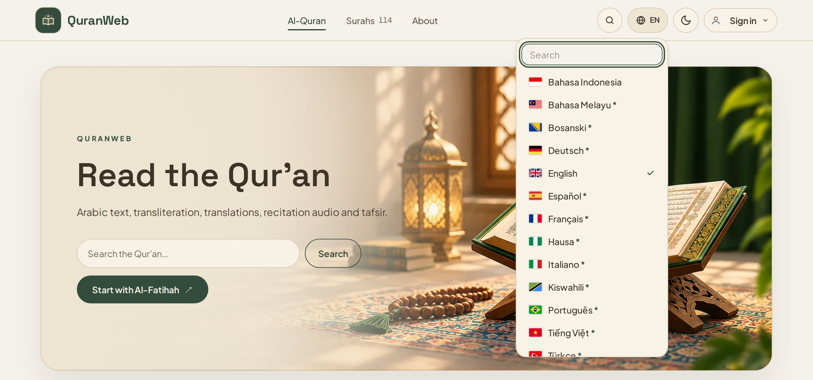
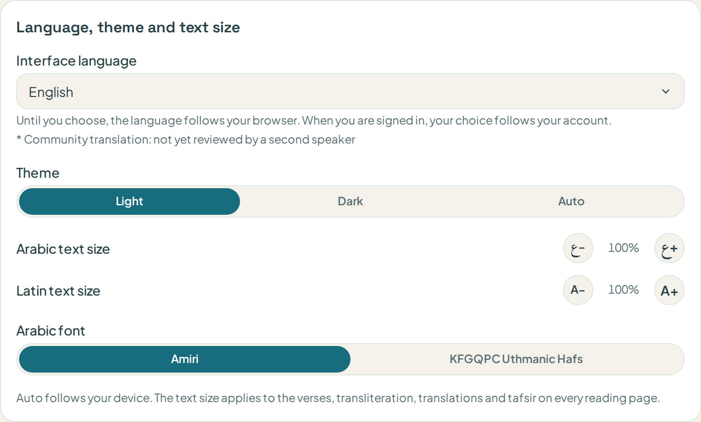

# QuranWeb

**English** · [Bahasa Indonesia](README.id.md)

A free website for reading the Qur'an: the Arabic text, translations (Indonesian, English, Turkish, Malay, Bengali, French, Russian, Urdu, Persian, Spanish, Bosnian, Chinese, Thai, Uzbek, Tamil, Malayalam, German, Portuguese, Hindi, Swahili, Hausa, Japanese, Vietnamese and others), recitation
audio and tafsir. You do not need an account, and there are no ads. Visits are counted with Cloudflare Web Analytics, which,
according to Cloudflare, sets no cookies and does not identify you (see the privacy policy).

**Open it at https://quranweb.udienz.web.id**

## What you can do

- **Read all 114 surahs** in the Arabic text (Uthmani Hafs or the EQuran.id text), with a Latin transliteration and one or
  more translations side by side (Indonesian Kemenag, Yusuf Ali, Pickthall and others). ([how](#choose-the-text-and-translations))
- **Read like a printed mushaf**: the Arabic text of a page runs as one block, with the translation beside it (below it
  on phones). Prefer one card per verse? Switch it in the settings. ([how](#switch-between-mushaf-and-verse-by-verse))
- **Listen** to the recitation verse by verse, from 23 reciters. The best known are at the top of the list, and you can
  search by name. Playback moves on to the next verse by itself; at the end of a surah it stops, repeats the surah or goes
  on to the next one, as you choose. You can also **play a whole juz**, across surahs. ([how](#listen-to-a-recitation))
- **Control the audio** from your phone's lock screen (pause, next verse), or on a computer with Space (play or pause) and
  N and P (next and previous verse). A data-saver mode plays smaller files on mobile data. ([how](#control-the-audio))
- **Memorize**: hear each verse two, three or more times, repeat a range of verses (for example 2:1–5) as many
  times as you like, and blur the Arabic or the translation to test yourself, tapping a verse to check it. ([how](#memorize-a-passage))
- **Read the tafsir** of a verse in the Tafsir tab (Kemenag, Quraish Shihab, Jalalayn or Al-Mukhtasar;
  Al-Mukhtasar also in Arabic, English, Turkish, Bengali, French, Russian, Persian, Bosnian, Chinese, Thai, Uzbek, Tamil,
  Malayalam, Italian, Hindi, Japanese and Vietnamese). ([how](#read-the-tafsir))
- **Pick up where you stopped** with "continue reading", and mark how far you have read. ([how](#continue-reading-and-mark-your-progress))
- **Bookmark verses**, add your own notes, and group them into collections. ([how](#bookmarks-notes-and-collections))
- **Set a daily goal** (verses a day), keep a streak going, and see your progress towards a khatam. ([how](#set-a-daily-goal))
- **Use it in your language**: the interface is in 25 languages (the list is under [Languages](#languages)); Urdu, Arabic
  and Persian read right to left. Apart from Indonesian and English they are community translations, not yet checked by a
  second speaker (Turkish was translated by a reader, the other twenty-two are first drafts by Claude, an AI). The menu
  marks them with an asterisk (*) and a note, and each has a link to report a mistake. Each language shows a translation and a tafsir in that language by default, or in English when
  our sources have none. The site follows your browser's language until you pick one in the header or on the Settings page.
  When you are signed in, your choice follows you. ([how](#change-the-language))
- **Make it comfortable**: a light, dark or automatic theme, and larger or smaller Arabic and Latin text, each on its
  own, on the Settings page. When you are signed in, your settings follow you to your other devices. ([how](#theme-and-text-size))
- **Copy a verse**, or a link to it. ([how](#copy-a-verse-or-its-link)) A link to a surah shows a preview with its name, its meaning
  and its number of verses when you paste it into WhatsApp, Telegram or X.
- **Install it as an app** on your phone or computer, with its own icon and window: "Install app" in Chrome or Edge,
  "Add to Home Screen" in Safari on an iPhone. It still needs an internet connection. ([how](#install-it-as-an-app))

Long surahs are split into pages of 10 verses: a page of Al-Baqarah is about 230 KB instead of about 2 MB for the whole surah.

## Languages

The interface comes in the 25 languages below, listed as the language menu lists them: alphabetically by the language's own
name, Latin script first, each with a flag. Choosing one also sets the translation and tafsir a new reader sees first; you
can change both in Reading settings, and choose from every translation and tafsir whatever the interface language. Where
our sources have no translation or no tafsir in a language, the site shows the English one: those cells say "English".

| Interface | Translation shown first | Tafsir shown first |
|---|---|---|
| Bahasa Indonesia | Kemenag | Kemenag |
| Bahasa Melayu (Malay) | Abdullah Basmeih | Kemenag (Indonesian, which Malay readers follow easily) |
| Bosanski (Bosnian) | Rowwad Translation Center | Al-Mukhtasar |
| Deutsch (German) | Frank Bubenheim and Nadeem Elyas | English: Al-Mukhtasar |
| English | Yusuf Ali | Al-Mukhtasar |
| Español (Spanish) | Isa Garcia | English: Al-Mukhtasar |
| Français (French) | Rachid Maach | Al-Mukhtasar |
| Hausa | Abubakar Mahmoud Gumi | English: Al-Mukhtasar |
| Italiano (Italian) | English: Yusuf Ali | Al-Mukhtasar |
| Kiswahili (Swahili) | Ali Muhsin Al-Barwani | English: Al-Mukhtasar |
| Português (Portuguese) | Helmi Nasr | English: Al-Mukhtasar |
| Tiếng Việt (Vietnamese) | Rowwad Translation Center | Al-Mukhtasar |
| Türkçe (Turkish) | Diyanet İşleri | Al-Mukhtasar |
| Русский (Russian) | Elmir Kuliev | Al-Mukhtasar |
| Ўзбекча (Uzbek) | Rowwad Translation Center | Al-Mukhtasar |
| اردو (Urdu) | Muhammad Junagarhi | English: Al-Mukhtasar |
| العربية (Arabic) | none (the Arabic text only) | Al-Mukhtasar in Arabic |
| فارسی (Persian) | Rowwad Translation Center | Al-Mukhtasar |
| हिन्दी (Hindi) | Azizul Haq Al-Omari | Al-Mukhtasar |
| বাংলা (Bengali) | Muhiuddin Khan | Al-Mukhtasar |
| தமிழ் (Tamil) | Omar Sharif | Al-Mukhtasar |
| മലയാളം (Malayalam) | Abdul Hamid Haidar and Kunhi Muhammad | Al-Mukhtasar |
| ไทย (Thai) | Rowwad Translation Center | Al-Mukhtasar |
| 中文 (Chinese) | Ma Jian | Al-Mukhtasar |
| 日本語 (Japanese) | Saeed Sato | Al-Mukhtasar |

Unless the table says otherwise, a translation or tafsir is in the language of its row.

Every language except Bahasa Indonesia and English is a community translation, marked with an asterisk (*) in the menu:
no second speaker has reviewed it yet. If you speak one of them, a review is the most useful help you can give; it is what
makes the language official. [CONTRIBUTING.md](CONTRIBUTING.md), "From community to official", explains how.

## How to

The pictures show the English interface; the Indonesian README shows the Indonesian one. The bookmarks, goal and progress
in them are sample data.

Most choices are in **Reading settings**, below the surah list on the left of a surah. On a phone, open the folded "Surah
list and settings" panel above the surah. Every setting is also on the **Settings** page: open the person button at the
top right (it reads "Sign in" until you sign in) and choose Settings.

### Choose the text and translations

1. Open a surah from the home page, or type its name or number in the search box above the surah list.
2. In Reading settings, pick the Arabic text, then a language under Translation and one or more translations in it. Each
   one you add appears under the verse; remove one with the cross on its label.
3. Turn the Arabic text, the transliteration or the translation on or off in the same panel.

### Switch between mushaf and verse by verse

The picture at the top of this page is the mushaf layout.

1. In Reading settings, under Layout, choose **Mushaf** or **Verse by verse**.
2. On wide screens, "Hide surah list and settings" above the surah gives the text the whole width.

### Listen to a recitation

1. Choose a reciter in Reading settings or in the Audio section of the Settings page. Type part of a name in the search
   box at the top of the list to find one.
2. Press play on a verse. In the mushaf layout, tap the verse number first: a bar with the play button opens at the
   bottom.
3. To choose what happens at the end of the surah, use the list in the surah header (Stop at the end, Repeat the surah,
   Play the next surah).
4. To play a whole juz, pick it in the "Juz…" list in the surah header or under "Play a juz" on the Settings page.

### Control the audio

- On a phone, the lock screen shows the verse and the reciter, with pause and next and previous verse. Nothing to set up.
- On a computer, on a surah page: Space plays or pauses, N goes to the next verse, P to the previous one.
- On mobile data, set Audio quality to "Data saver" in the Audio section of the Settings page (picture above). It is kept
  on that device only. With some reciters it changes nothing, and the text under the list says so.

### Memorize a passage

1. Open the surah and press **Memorize** in its header.
2. "Play each verse" sets how many times each verse plays before the next one.
3. "Repeat verses": choose the first and last verse and how many times, then press **Start**. Press Stop to end it early.
4. "Hide while memorizing" blurs the Arabic text or the translation. Tap a blurred verse to check it, and tap again to hide
   it.

### Read the tafsir

1. Open the **Tafsir** tab in the surah header.
2. Choose the tafsir in Reading settings, under Tafsir.

### Continue reading and mark your progress

1. Just read: the site records the verse you reached. "Continue reading" on the home page takes you back to it.
2. To mark how far you have read, press the check button on a verse ("Mark as read up to this verse"). In the mushaf
   layout it is in the bar that opens when you tap a verse number. Verses marked as read get a line beside them.
3. Your progress per surah is on the **My reading** page (person button at the top right, then My reading).

### Bookmarks, notes and collections

1. Press the bookmark button on a verse.
2. A bookmarked verse shows "Add a note" under it: write your note there.
3. On My reading, under Bookmarks, type a name in "New collection" and press **Add**. Then put a bookmark in it with the
   list beside that bookmark. The buttons at the top show one collection at a time.

### Set a daily goal

1. On My reading, under Daily goal, choose how many verses a day.
2. Only verses you mark as read count (see above); reading without marking does not.
3. The page shows today's count, how many days in a row you reached the goal, and how far you are towards a khatam.

### Change the language

Press the globe button at the top (it shows the code of the current language, such as EN or FR) and pick a language, or use "Interface language" on the
Settings page. The languages are in alphabetical order of their own names, each with a flag; the menu scrolls when it is
taller than the screen. This changes the menus and buttons only. The translations of the Qur'an are chosen in Reading settings.

### Theme and text size

1. The moon or sun button at the top switches between light and dark.
2. For the automatic theme, which follows your device, and for the text size, go to the Settings page, section
   "Language, theme and text size". The Arabic and the Latin text each have their own size buttons.

### Copy a verse or its link

Press the copy button on a verse for its text, or the link button for a link straight to that verse. In the mushaf
layout, tap the verse number first (picture under "Continue reading and mark your progress").

### Install it as an app

- Chrome or Edge on a computer or Android phone: choose "Install app" (in the address bar or the browser menu).
- Safari on an iPhone: the Share button, then "Add to Home Screen".

The app still needs an internet connection.

## Your reading and your privacy

Without an account, everything you do (where you stopped, bookmarks, notes, your goal) stays in your browser on that
device. From "My reading" you can save it to a file and import it again, on the same or another device.

If you want the same reading on your phone and your computer, you can sign in with your Google account. It is optional.
You can download everything kept with your account, or delete the account, at any time. What is kept and why is in the
privacy policy: https://quranweb.udienz.web.id/privacy.

## Sources and credits

The Arabic text, translations and tafsir come from published sources: [EQuran.id](https://equran.id) (the Arabic text,
translation and tafsir of Kementerian Agama RI, and the recitations), [fawazahmed0/quran-api](https://github.com/fawazahmed0/quran-api) and
[QuranEnc.com](https://quranenc.com); more recitations come from the [AlQuran.cloud](https://alquran.cloud/cdn) audio CDN. The **About** page,
linked at the bottom of every page, lists the source, credit and licence of every text, translation, tafsir and
recitation.

## On a phone

On wide screens the surah list and settings sit beside the surah; on phones they are in a folded panel above it:

  
  

## Feedback and help

Found a mistake, or have an idea? [Open an issue](https://github.com/udienz/quranweb/issues). Thanks to everyone who has
helped: see [CONTRIBUTORS.md](CONTRIBUTORS.md).

You can also help by translating the interface (menus, buttons, pages) into your language. The Qur'an itself is never
translated this way. How it works: [CONTRIBUTING.md](CONTRIBUTING.md), section "Translating the interface".

## Licence

The **code** of QuranWeb is free to use, change and share under the [MIT licence](LICENSE), without any warranty. The text of
the Qur'an, the translations, the tafsir and the recitations are **not** covered by it: each keeps the terms of its source,
listed on the About page of the site.

## For developers

Running it locally, Docker, the data sources, the environments and deployment are described in
[docs/development.md](docs/development.md). The project's conventions are in [CLAUDE.md](CLAUDE.md).
